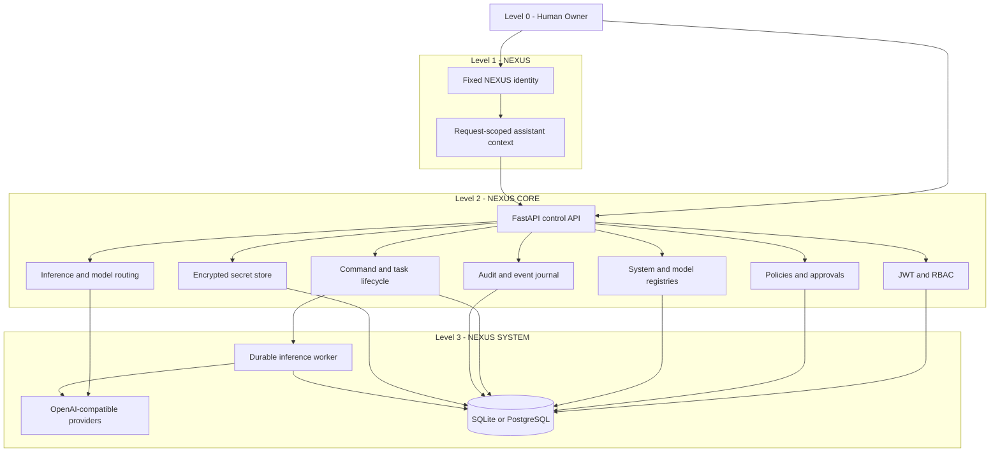
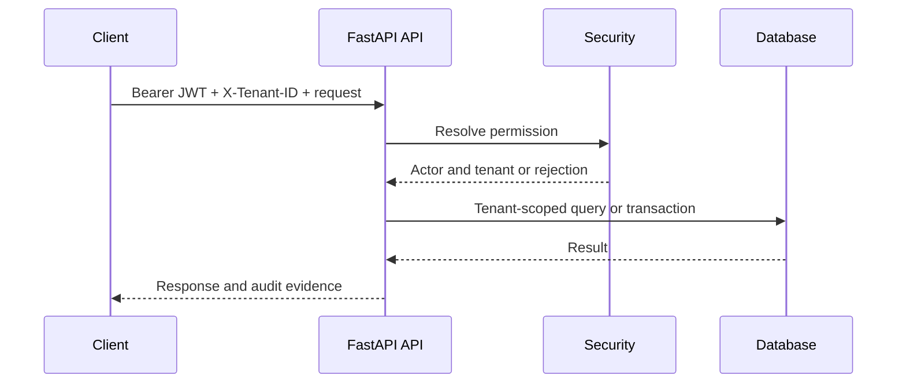
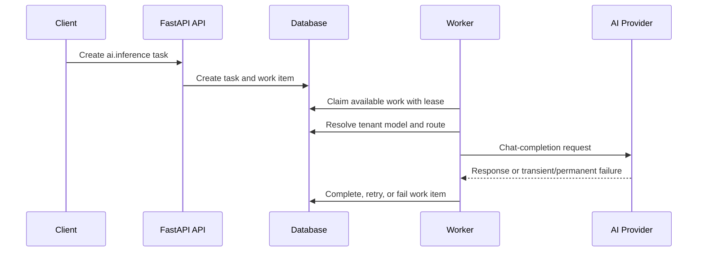

# Phase 01 - Supreme Architecture

| Field | Value |
|---|---|
| Phase | 01 |
| Name | Supreme Architecture |
| Deliverable | Architecture Specification |
| Status | VALIDATED |
| Change ID | NEXUS-PHASE-01 |
| Version | 1.0 |
| Document ID | NEXUS-SAI-MB-001 |

## 1. Specification

Phase 01 defines the Supreme Three-Tier Architecture for NEXUS. It is an
implementation-oriented specification: components marked as implemented are
present in the MVP, while components marked as future are explicitly not
represented as complete.

## 2. Three-Tier Model



### Level 1 - NEXUS

NEXUS is the conceptual supreme authority and product identity.

Implemented:

- A fixed NEXUS identity prompt for assistant requests
- Request-scoped chat context
- Human-owner supreme authority represented through governance decisions

Not implemented:

- Persistent executive memory
- Goal and strategic planning engines
- Autonomous strategic decision engine
- Authority hierarchy beyond current JWT roles and tenant scope

### Level 2 - NEXUS CORE

NEXUS CORE is implemented as a modular FastAPI monolith. It owns application
interfaces, authorization, governance decisions, registry management, task
coordination, and audit.

| Component | Responsibility | Implementation |
|---|---|---|
| Control API | HTTP composition and routing | `app/main.py`, `app/api/routes.py` |
| Identity and authorization | JWT claims, role permissions, tenant scope | `app/security.py` |
| Governance | Command policies, approval separation, emergency stop | API routes and data models |
| Configuration and secrets | Non-secret configuration and encrypted secrets | `app/core/config.py`, `app/secrets.py` |
| Registries | Systems and AI models | SQLAlchemy models and API routes |
| Task control | Manual task lifecycle and work-item coordination | Control API and SQLAlchemy models |
| AI engine | Chat inference and deterministic model routing | `app/ai/` |
| Audit | Tenant audit events and control event journal | SQLAlchemy models and API routes |
| Persistence | Transactional application state | `app/core/database.py`, `app/models.py` |

### Level 3 - NEXUS SYSTEM

The operational layer consists of workers and external execution targets.

Implemented:

- A separate durable inference worker process
- Database-backed work claims and leases
- OpenAI-compatible provider integration
- SQLite local persistence and PostgreSQL deployment persistence
- Docker Compose API, worker, and PostgreSQL services

Not implemented:

- Agent society
- General-purpose agent runtime
- Sandbox isolation
- Workflow or event broker execution
- Resource, application, and cloud operation services

## 3. Architecture Boundaries

### API boundary

All application operations enter through versioned REST paths under
`/api/v1`. `/health` is an operational liveness endpoint. The API does not
issue JWTs; trusted identity providers must supply signed JWTs.

### Trust boundary

Every protected route declares a permission. JWT `sub`, `role`, and
`tenant_id` claims are checked against `X-Tenant-ID`. The token tenant must
match the request tenant and the role must grant the declared permission.

### Data boundary

Application records carry tenant scope. Tenant isolation is implemented at
the API and database query level for management resources. A database shared
by multiple tenants is therefore a logical isolation boundary, not a dedicated
database security boundary.

### Execution boundary

The API creates work items and records state. The worker claims work through
database state, executes it, and writes the outcome back. Provider calls are
outside the application process and therefore require network and credential
failure handling.

### Secret boundary

Tenant configuration values are non-secret application data. Tenant secret
values are encrypted with an external application key and are not returned by
the HTTP API. Provider credentials are environment-managed and are not written
to the database.

## 4. Runtime Flows

### Protected API request



### Command lifecycle

```text
RECEIVED -> APPROVED -> EXECUTING -> COMPLETED
                               -> FAILED
RECEIVED/APPROVED/EXECUTING -> CANCELLED
```

Every command is tenant-scoped and has policy decision evidence. Approval
requires an independent subject when the effective policy requires it.
Emergency stop blocks execution and work claiming.

### Durable inference work



The worker uses database leases and at-most three attempts. Processing is
at-least-once: a provider timeout may cause a repeated provider request.

## 5. Data Architecture

The primary repository uses SQLAlchemy models and supports SQLite and
PostgreSQL.

Architectural domains:

| Domain | Tables or concepts |
|---|---|
| Identity | JWT claims and authenticated actors; no local user store yet |
| Governance | Command policies, payload rules, policy versions |
| Core | Commands, tasks, work items, emergency stop |
| Registries | Systems and AI models |
| Operations | Control events and audit events |
| Configuration | Tenant configuration and encrypted tenant secrets |

PostgreSQL is the deployment database target. SQLite is for local development
and tests. Alembic is declared as a dependency, but production migrations are
not yet implemented; schema changes must not be represented as production-safe
migrations until migration tooling is added.

## 6. Deployment Architecture

Docker Compose separates application processes but shares the database:

- `api`: handles HTTP requests
- `worker`: claims and executes queued inference work
- `postgres`: provides persistent application data

The API and worker share the database and settings contract. Horizontal API
and worker scaling are structurally possible, but require database-supported
claim semantics and external provider configuration. Health monitoring,
metrics, log aggregation, backup automation, and HA database setup remain
future work.

## 7. Architecture Decisions

| Decision | Status | Rationale |
|---|---|---|
| Modular monolith before microservices | Adopted | Minimizes operational complexity while preserving module boundaries |
| REST API under `/api/v1` | Adopted | Provides a clear versioned control and management interface |
| JWT plus RBAC in application | Adopted | Keeps MVP tenant authorization deterministic and auditable |
| SQLAlchemy with SQLite/PostgreSQL | Adopted | Supports local testing and a PostgreSQL deployment target |
| Database-backed worker leases | Adopted | Prevents a single process from owning the queue and supports retries |
| OpenAI-compatible provider as first adapter | Adopted | Provides a standard hosted/local provider contract |
| Event journal instead of broker | Adopted | Records events without falsely claiming broker delivery semantics |
| External JWT issuer | Adopted | Separates identity issuance from application authorization |
| Application-level secret encryption | Adopted | Provides at-rest database protection for MVP tenant secrets |

## 8. Quality Attributes

| Attribute | Phase 01 architecture measure |
|---|---|
| Auditability | Audit events and immutable policy versions |
| Tenant isolation | JWT tenant checks and tenant-scoped queries |
| Fail-safe behavior | Fail-closed command policy defaults and emergency stop |
| Evolvability | Separate modules and provider/task adapters |
| Operability | Health endpoint, Docker Compose, separate worker process |
| Reliability | Work leases, retries, and persisted task state |
| Confidentiality | Fernet tenant-secret encryption and external secret keys |
| Testability | Dependency overrides and isolated SQLite pytest fixture |

## 9. Acceptance Criteria

| ID | Criterion | Evidence |
|---|---|---|
| SA-01 | The three-tier model is documented | Section 2 |
| SA-02 | Core and system responsibilities are defined | Component tables |
| SA-03 | Trust and tenant boundaries are explicit | Section 3 |
| SA-04 | Protected request flow is documented | Request sequence |
| SA-05 | Command and inference execution flows are documented | Sections 4 |
| SA-06 | Persistence domains and deployment topology are documented | Sections 5 and 6 |
| SA-07 | API, worker, security, data, and deployment are represented in code | Repository modules and Docker Compose |
| SA-08 | Architecture claims match implementation without overstating readiness | Explicit implemented and not implemented lists |
| SA-09 | Architecture has executable validation | Pytest suite |

## 10. Test Evidence

Run:

```bash
./.venv/bin/pytest -q
```

The suite verifies runtime behavior and the architecture implementation
invariants described by this phase.

## 11. Reason and Impact Analysis

Reason:

- Convert the roadmap's Supreme Architecture concept into a reviewable
  implementation specification.

Impact:

- Establishes module boundaries and runtime/deployment contracts.
- Prevents later phases from assuming unimplemented agent, memory, workflow,
  event-broker, or sandbox capabilities.
- Does not replace the Phase 02 governance implementation or the separate
  AI Engine and Model Intelligence specifications.

## 12. Approval and Change Record

- Implementation: complete for the MVP architecture specified here
- Testing: complete
- Validation: complete
- Human owner approval: pending where formal organizational approval is required
